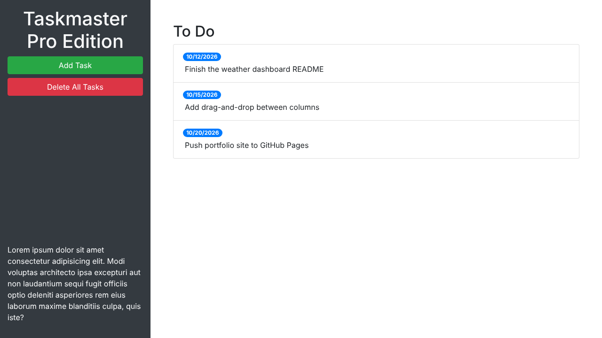

<h1 align="center">✅ Taskmaster Pro</h1>

<p align="center">A lightweight task tracker that runs in the browser. Add tasks with due dates and they are saved automatically.</p>

<p align="center">
  
  
  
  
  
</p>

<p align="center"></p>

## Features

- Add a task with a description and due date through a pop-up form
- Tasks show in a **To Do** list with their due date as a badge
- Tasks are saved in the browser's `localStorage`
- **Remove All Tasks** button to clear the board
- Data model already tracks **In Progress**, **In Review** and **Done** lists, ready for those columns to be added to the page

## Built With

- HTML, CSS, JavaScript
- [jQuery](https://jquery.com/)
- [Bootstrap 4](https://getbootstrap.com/docs/4.3/) (layout and modal)

## Running Locally

No build step is needed.

1. Clone the repo:
   ```bash
   git clone https://github.com/ChristianKrantz11/taskmaster-pro.git
   ```
2. Open `index.html` in your browser.

## Project Structure

```
├── index.html
└── assets/
    ├── css/style.css
    └── js/script.js
```

## Author

[ChristianKrantz11](https://github.com/ChristianKrantz11)
